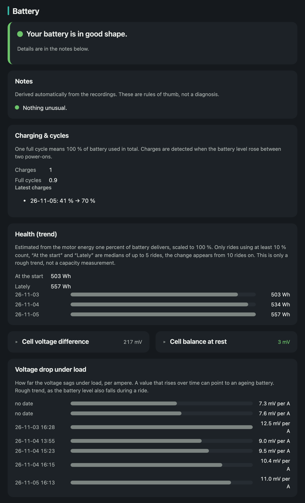
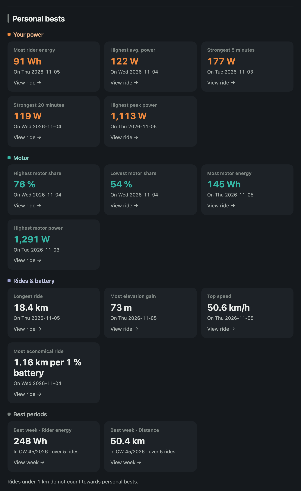
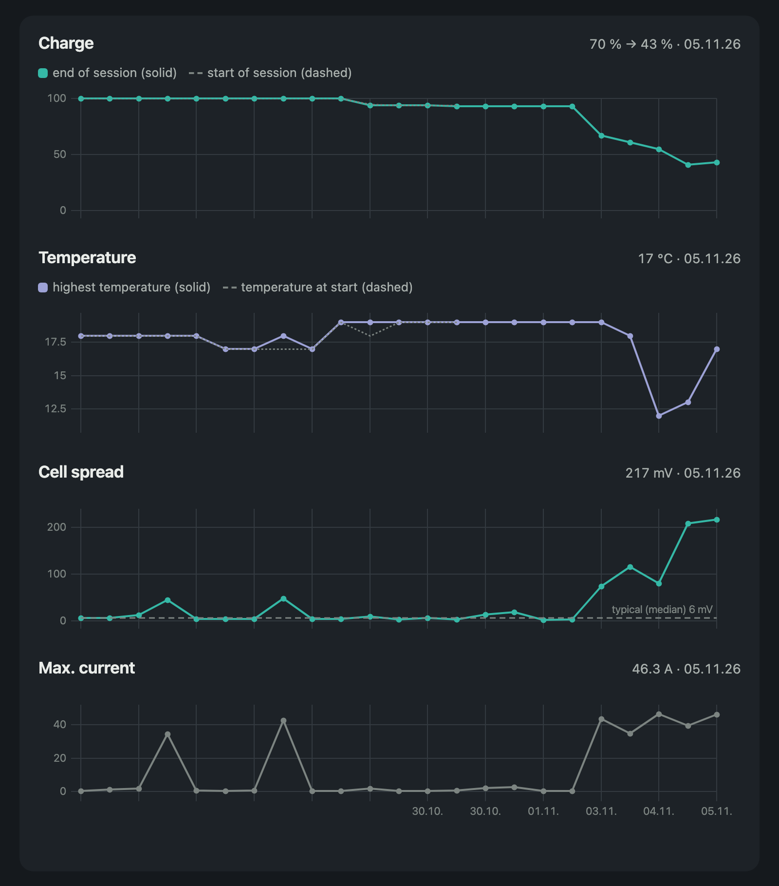

<p align="center"></p>

<p align="center"><a href="README.md">Deutsch</a> · <b>English</b></p>

[](https://github.com/ManuelW77/avinox-ridedata-server/actions/workflows/build.yml)

# avinox-ridedata-server

Read and analyse ride data from the DJI Avinox e-bike drive (e.g. Amflow PR) straight from the display's USB drive – no Avinox cloud, no credentials.

## It is that simple

**Plug an ESP32 into the display's USB port, set up Wi-Fi once, done.** From then on every ride lands on your own server automatically.

**All data stays local** in your own network. No cloud account, no sharing.

## What you get

- **Your totals at a glance:** distance, riding time, elevation and calories per day, week, month, year or all time, compared with the previous period. A bar shows how much energy you pedalled yourself and how much the motor added.
- **Personal bests:** strongest 5 and 20 minutes, highest peak power, longest ride, most climbing, top speed, most efficient ride (km per percent of battery), best week.
- **Every ride in detail:** a map of the track, coloured by speed, rider or motor power, altitude or assist mode. Plus charts for altitude, speed, power, cadence, battery and temperature.
- **Track in 3D:** replay the ride as a flight over the terrain, with exaggerated relief and buildings if you like.
- **How you ride:** time per assist mode and gear, cadence per gear, distributions of power, speed and gradient, power uphill and downhill.
- **Battery health in one sentence:** “Your battery is in good shape” plus notes. Behind it: charges and full cycles, health trend (usable Wh), cell balance, voltage drop under load and charts for charge level, temperature, cell deviation and current.
- **Ride list** with automatic names (e.g. “Loop around …”, can be switched off), renaming, search, filters and route previews.
- **Export** as GPX (with power, cadence, heart rate), GeoJSON and JSON.
- **Convenient:** light and dark mode, German and English, your own names for assist modes, file upload in the browser, Wi-Fi firmware updates for the ESP32, a sync page with the ESP32’s reports.

## Screenshots

<table>
<tr>
<td width="50%"><br><sub>Overview: totals, your share vs. the motor, charts</sub></td>
<td width="50%"><br><sub>Ride: key figures and charts</sub></td>
</tr>
<tr>
<td width="50%"><br><sub>Battery: health, cycles, trend, voltage drop</sub></td>
<td width="50%"><br><sub>Personal bests</sub></td>
</tr>
<tr>
<td width="50%"><br><sub>Ride: modes, gears and distributions</sub></td>
<td width="50%"><br><sub>Battery history per session</sub></td>
</tr>
</table>

The map and 3D view are left out on purpose because they show real GPS tracks.

## Requirements

- **ESP32-S3 board with two USB ports:** one native (to the display) and one UART port (for flashing).
  Recommended and tested: [ESP32-S3-N16R8 with RGB LED](https://link.amazon/B08n7R9ww). The LED shows the status, no extra parts needed.
- **Computer or NAS with Docker**, reachable on the same Wi-Fi.

## Installation

### a) Server with Docker

`docker-compose.yml`:

```yaml
services:
  avinox:
    image: ghcr.io/manuelw77/avinox-ridedata-server:latest
    restart: unless-stopped
    ports:
      - "8000:8000"
    volumes:
      - avinox-data:/data
    environment:
      AVINOX_DATA_DIR: /data
      # Initial admin (turns the login on)
      # AVINOX_WEB_USER: "avinox"
      # AVINOX_WEB_PASSWORD: "change-me"

volumes:
  avinox-data:
```

```sh
docker compose up -d
```

The web page is then available at `http://<host>:8000/`. All data lives in the volume `/data`.

The server creates the upload token for the ESP32 on first start:

```sh
docker compose exec avinox cat /data/upload_token
```

**Login:** `AVINOX_WEB_USER`/`AVINOX_WEB_PASSWORD` create an administrator at startup and turn the login on (sign-in form, more users under Settings). Signing in via OpenID Connect is optional (`AVINOX_OIDC_*`, see [server/README.md](server/README.md), German). **Warning:** Without any user or OIDC the web page is open to everyone on your LAN. Do not expose it to the internet without a login. All settings: [server/README.md](server/README.md) (German).

### b) Flash the ESP32 once

Download `avinox-sync-full.bin` from the [latest release](https://github.com/ManuelW77/avinox-ridedata-server/releases/latest). Connect the ESP32 to the **UART port** and flash:

```sh
esptool.py --chip esp32s3 write_flash 0x0 avinox-sync-full.bin
```

Build it yourself with ESP-IDF v6.0.2: `idf.py set-target esp32s3 build flash` in `esp32/avinox-sync`, see [esp32/avinox-sync/README.md](esp32/avinox-sync/README.md) (German).

Then connect the ESP32's **native port** to the display with a USB-C cable. The display powers it.

### c) First setup via the ESP32's Wi-Fi

1. Power the ESP32. Without a configuration it starts setup mode and the LED blinks purple.
2. With a phone or laptop, join the Wi-Fi `Avinox-Sync-XXXX`. The first time it is open. The portal usually opens by itself, otherwise browse to `http://192.168.4.1`.
3. Pick your home Wi-Fi and enter its password. Enter the server URL (e.g. `http://<host>:8000`) and the upload token. Set an **access password** (at least 8 characters, not your home Wi-Fi password). It protects the setup Wi-Fi `Avinox-Sync-XXXX` and the ESP32 web interface.
4. Optionally "Check connection": tests without saving whether Wi-Fi, server and token are correct (in the setup Wi-Fi the connection may drop briefly).
5. "Save and restart".

Set up again: hold the BOOT button for 3 s. Factory reset: hold BOOT for 10 s.

**Web interface in normal operation:** Once the ESP32 is on your home Wi-Fi, open `http://<ESP32 IP>/` (IP from your router). Login: user **`avinox`** (fixed), password = access password, the same as for the setup Wi-Fi. There you see the status and change Wi-Fi, server URL, token and password.

**Fallback (password forgotten or wrong Wi-Fi entered):** Hold the BOOT button for 3 s and release it. The ESP32 then opens the setup Wi-Fi **without a password**, and when saving you set a new access password and enter the upload token again (shown on the server under Settings). Without saving it restarts normally after 15 min.

### d) Updates over Wi-Fi (OTA)

Upload the new `avinox-sync.bin` (from the release) to the server under **Settings → Firmware** and mark it as current. This only works with the login turned on and as an administrator. The ESP32 checks after every sync and at the latest every 6 hours, downloads the new version and restarts. If the new firmware does not report to the server, it rolls back to the old one.

## How a sync works

```
Display (USB drive) ──read──▶ ESP32-S3 ──Wi-Fi──▶ Server (Docker) ──▶ Web page
```

1. The ESP32 waits for the drive and Wi-Fi.
2. It fetches the manifest from the server (known files with path and size).
3. It mounts the drive (read-only) and searches only `ride_rec/`, `buried_rec/` and `hms_rec/`.
4. A file is new if its name and size are not in the manifest. File times are ignored, the display reports the year 2098.
5. It uploads new files in chunks. After an interruption it resumes where the server left off.
6. It unmounts the drive and sends a sync report (page `/sync`).
7. The next sync follows after 10 minutes, as long as drive and Wi-Fi are present.

| LED | Meaning |
|---|---|
| purple blinking | setup mode |
| blue blinking | waiting for drive and/or Wi-Fi |
| orange blinking | no drive for 30 s: display on? Native port? |
| cyan | sync running |
| white, slow blinking | firmware update downloading |
| green | sync ok, up to date |
| yellow | sync with errors (server unreachable, wrong token …) |
| red | severe error (USB host, drive, storage, setup Wi-Fi) |

All states: [esp32/avinox-sync/README.md](esp32/avinox-sync/README.md) (German).

## Folders

| Folder / file | Content |
|---|---|
| [`server/`](server/README.md) | Parser, analysis, server, Docker |
| [`esp32/`](esp32/avinox-sync/README.md) | Firmware `avinox-sync`; next to it `usb-probe` = feasibility test |
| [`ERKENNTNISSE.md`](ERKENNTNISSE.md) | File format, data paths, field mapping (German) |
| `assets/` | Icon, Screenshots |

## Notes

- The file format is not officially documented. The field mapping comes from community reverse engineering, among others [lucad87/avinox-setup-app](https://github.com/lucad87/avinox-setup-app) (MIT), and our own checks. Verify values against the Avinox app before trusting them.
- Ride files contain the serial number and the GPS track. Do not share your own files publicly.
- The ESP32 firmware has seen little testing on the real device. Details: [esp32/avinox-sync/README.md](esp32/avinox-sync/README.md).

## License

GPL-3.0-or-later, see [LICENSE](LICENSE).

---

© 2026 Manuel Weiser · Build with ❤️ and a 🚲 by Manuel Weiser in Leipzig · [manuelw.de](https://manuelw.de)
