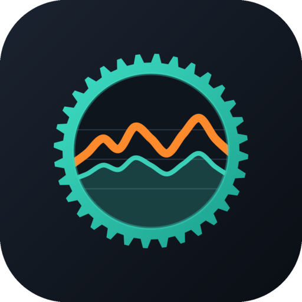
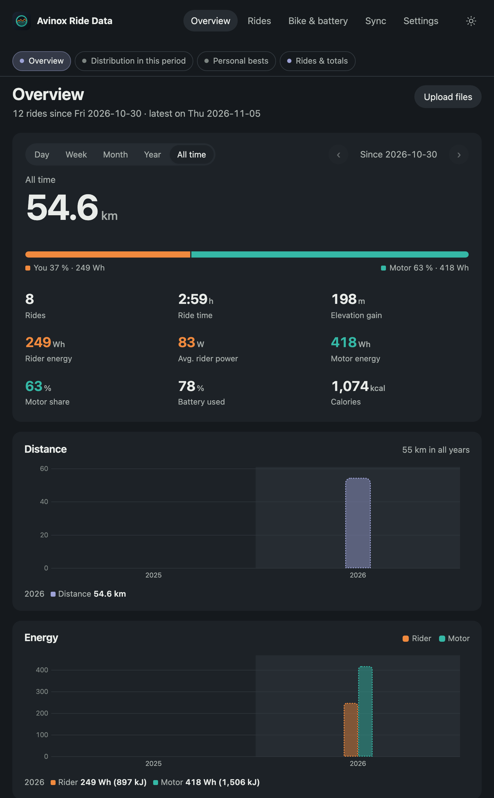
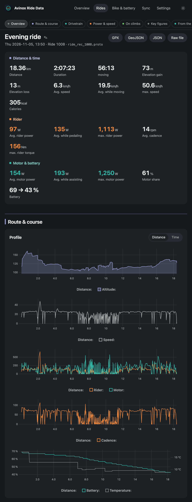
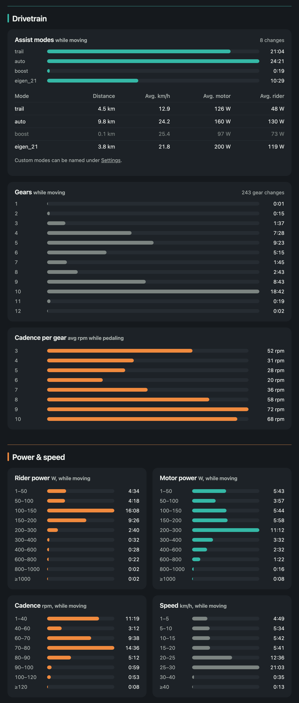

<p align="center"></p>

<p align="center"><a href="README.md">Deutsch</a> · <b>English</b></p>

[](https://github.com/ManuelW77/avinox-ridedata-server/actions/workflows/build.yml)

# avinox-ridedata-server

Read and analyse ride data from the DJI Avinox e-bike drive (e.g. Amflow PR) straight from the display's USB drive – no Avinox cloud, no credentials.

## It is that simple

**Plug an ESP32 into the display's USB port, set up Wi-Fi once, done.** From then on every ride lands on your own server automatically.

**All data stays local** in your own network. No cloud account, no sharing.

## What you get

- **Overview** with periods (day, week, month, year), comparison and best values; ride list at `/rides`.
- **Ride details** with a map (GPS track with measured values) and charts: power, cadence, speed, gradient, heart rate.
- **Statistics:** time per assist mode and gear, distributions, best efforts from 5 s to 60 min, energy and motor share, battery use, stops.
- **Device:** firmware, battery (cell voltages, current, temperatures), usage statistics, drive messages.
- **Export** as GPX (with power, cadence, heart rate) and GeoJSON.
- **Sync page** (`/sync`) with the ESP32's status and reports.

## Screenshots

<table>
<tr>
<td width="50%"><br><sub>Overview with periods, statistics and personal bests</sub></td>
<td width="50%"><br><sub>Ride details with key figures and charts</sub></td>
</tr>
</table>



*Assist modes, gears, distributions and best efforts of a ride*

## Requirements

- **ESP32-S3 board with two USB ports:** one native (to the display) and one UART port (for flashing).
- **Computer or NAS with Docker**, reachable on the same Wi-Fi.

## Installation

### a) Server with Docker

`docker-compose.yml`:

```yaml
services:
  avinox:
    image: ghcr.io/manuelw77/avinox-ridedata-server:latest
    restart: unless-stopped
    ports:
      - "8000:8000"
    volumes:
      - avinox-data:/data
    environment:
      AVINOX_DATA_DIR: /data
      # AVINOX_WEB_USER: "avinox"
      # AVINOX_WEB_PASSWORD: "change-me"

volumes:
  avinox-data:
```

```sh
docker compose up -d
```

The web page is then available at `http://<host>:8000/`. All data lives in the volume `/data`.

The server creates the upload token for the ESP32 on first start:

```sh
docker compose exec avinox cat /data/upload_token
```

**Warning:** Without `AVINOX_WEB_USER`/`AVINOX_WEB_PASSWORD` the web page is open to everyone on your LAN. Do not expose it to the internet without a password. All settings: [server/README.md](server/README.md) (German).

### b) Flash the ESP32 once

Download `avinox-sync-full.bin` from the [latest release](https://github.com/ManuelW77/avinox-ridedata-server/releases/latest). Connect the ESP32 to the **UART port** and flash:

```sh
esptool.py --chip esp32s3 write_flash 0x0 avinox-sync-full.bin
```

Build it yourself with ESP-IDF v6.0.2: `idf.py set-target esp32s3 build flash` in `esp32/avinox-sync`, see [esp32/avinox-sync/README.md](esp32/avinox-sync/README.md) (German).

Then connect the ESP32's **native port** to the display with a USB-C cable. The display powers it.

### c) First setup via the ESP32's Wi-Fi

1. Power the ESP32. Without a configuration it starts setup mode and the LED blinks purple.
2. With a phone or laptop, join the Wi-Fi `Avinox-Sync-XXXX`. The first time it is open. The portal usually opens by itself, otherwise browse to `http://192.168.4.1`.
3. Pick your home Wi-Fi and enter its password. Enter the server URL (e.g. `http://<host>:8000`) and the upload token. Set your own password for the setup Wi-Fi (at least 8 characters).
4. "Save and restart".

Set up again: hold the BOOT button for 3 s. Factory reset: hold BOOT for 10 s.

### d) Updates over Wi-Fi (OTA)

Upload the new `avinox-sync.bin` (from the release) to the server under **Settings → Firmware** and mark it as current. This only works when a web password is set. The ESP32 checks after every sync and at the latest every 6 hours, downloads the new version and restarts. If the new firmware does not report to the server, it rolls back to the old one.

## How a sync works

```
Display (USB drive) ──read──▶ ESP32-S3 ──Wi-Fi──▶ Server (Docker) ──▶ Web page
```

1. The ESP32 waits for the drive and Wi-Fi.
2. It fetches the manifest from the server (known files with path and size).
3. It mounts the drive (read-only) and searches only `ride_rec/`, `buried_rec/` and `hms_rec/`.
4. A file is new if its name and size are not in the manifest. File times are ignored, the display reports the year 2098.
5. It uploads new files in chunks. After an interruption it resumes where the server left off.
6. It unmounts the drive and sends a sync report (page `/sync`).
7. The next sync follows after 10 minutes, as long as drive and Wi-Fi are present.

| LED | Meaning |
|---|---|
| purple blinking | setup mode |
| blue blinking | waiting for drive and/or Wi-Fi |
| orange blinking | no drive for 30 s: display on? Native port? |
| cyan | sync running |
| white, slow blinking | firmware update downloading |
| green | sync ok, up to date |
| yellow | sync with errors (server unreachable, wrong token …) |
| red | severe error (USB host, drive, storage, setup Wi-Fi) |

All states: [esp32/avinox-sync/README.md](esp32/avinox-sync/README.md) (German).

## Folders

| Folder / file | Content |
|---|---|
| [`server/`](server/README.md) | Parser, analysis, server, Docker |
| [`esp32/`](esp32/avinox-sync/README.md) | Firmware `avinox-sync`; next to it `usb-probe` = feasibility test |
| [`ERKENNTNISSE.md`](ERKENNTNISSE.md) | File format, data paths, field mapping (German) |
| `assets/` | Icon |

## Notes

- The file format is not officially documented. The field mapping comes from community reverse engineering, among others [lucad87/avinox-setup-app](https://github.com/lucad87/avinox-setup-app) (MIT), and our own checks. Verify values against the Avinox app before trusting them.
- Ride files contain the serial number and the GPS track. Do not share your own files publicly.
- The ESP32 firmware has seen little testing on the real device. Details: [esp32/avinox-sync/README.md](esp32/avinox-sync/README.md).

## License

GPL-3.0-or-later, see [LICENSE](LICENSE).

---

© 2026 Manuel Weiser · Build with ❤️ and a 🚲 by Manuel Weiser in Leipzig · [manuelw.de](https://manuelw.de)
