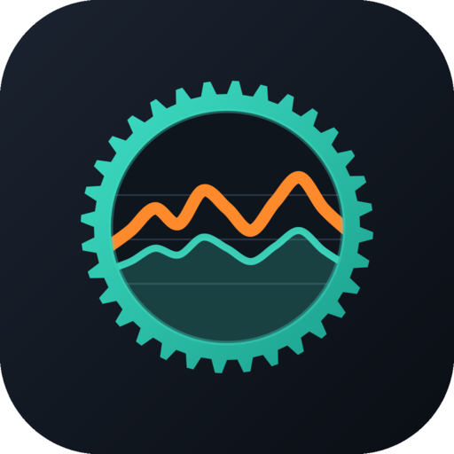
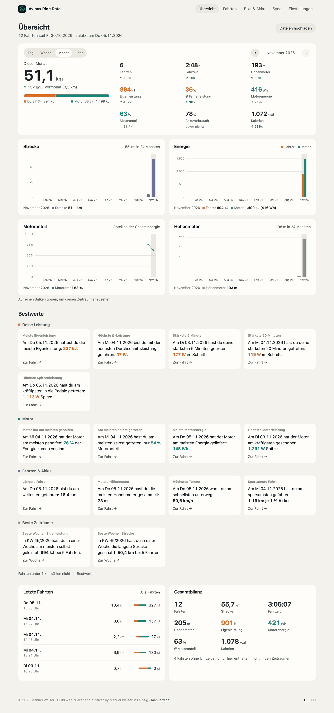
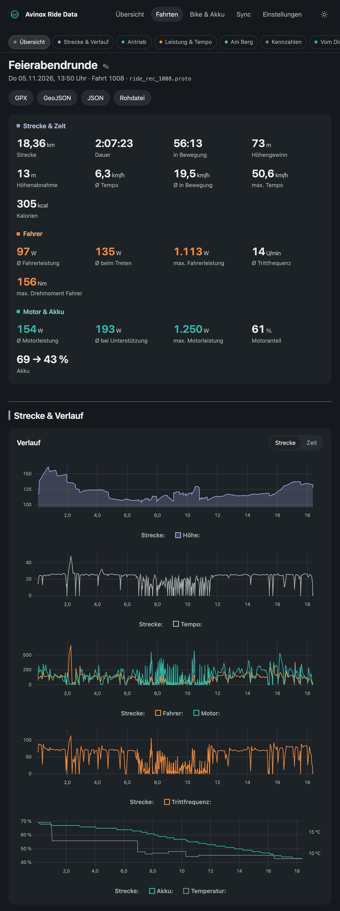
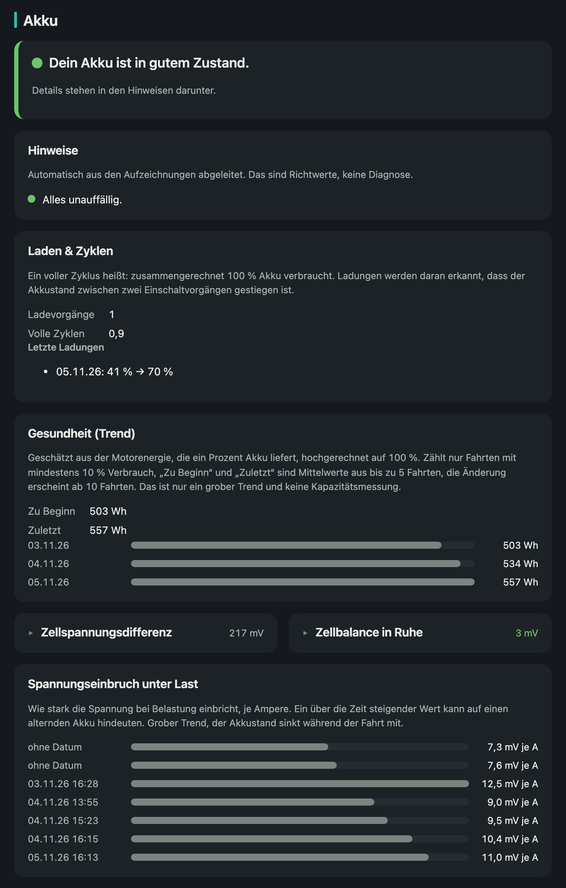
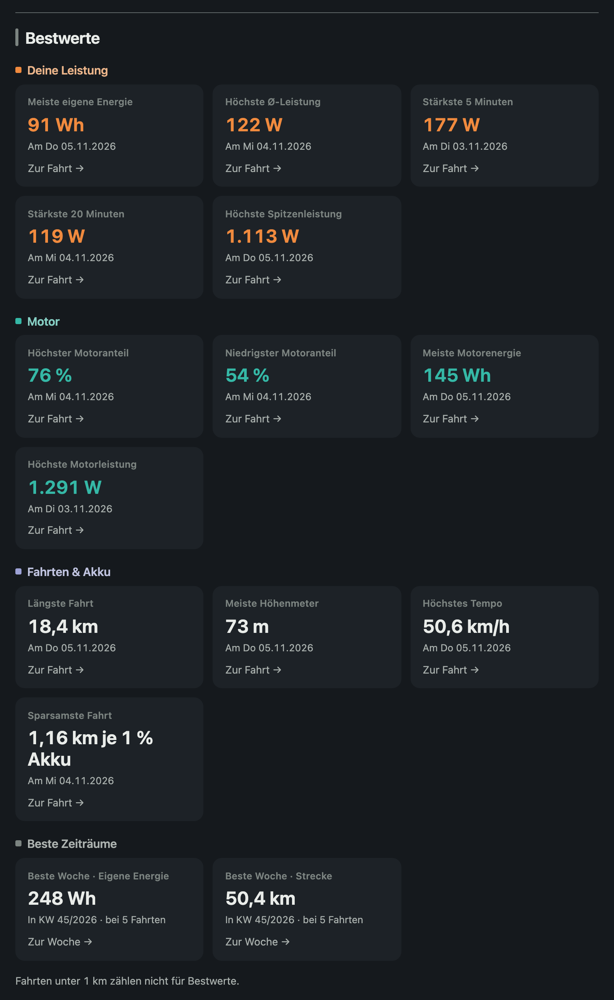
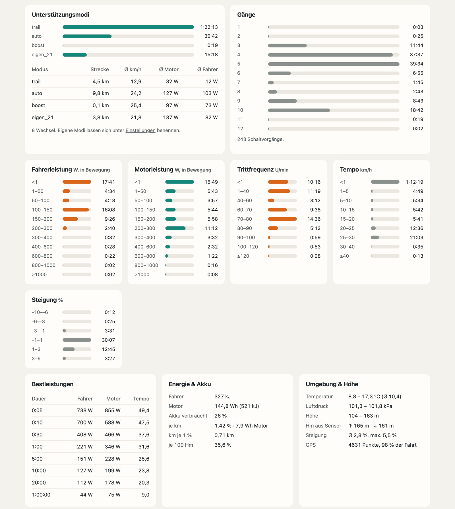
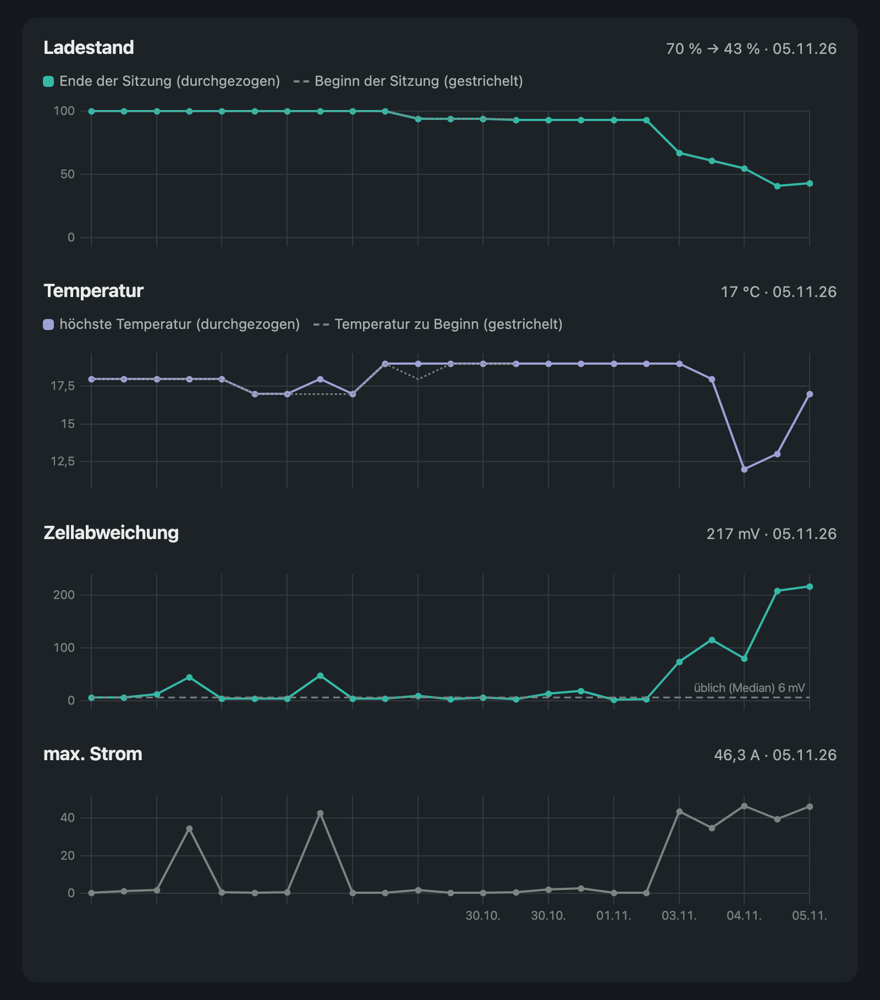

<p align="center"></p>

<p align="center"><b>Deutsch</b> · <a href="README.en.md">English</a></p>

[](https://github.com/ManuelW77/avinox-ridedata-server/actions/workflows/build.yml)

# avinox-ridedata-server

Fahrdaten vom DJI-Avinox-E-Bike-Antrieb (z. B. Amflow PR) direkt vom USB-Laufwerk des Displays auslesen und auswerten – ohne Avinox-Cloud, ohne Zugangsdaten.

## So einfach

**ESP32 an den USB-Port des Displays stecken, einmal WLAN einrichten, fertig.** Jede Fahrt landet danach automatisch auf dem eigenen Server.

**Alle Daten bleiben lokal** im eigenen Netz. Kein Cloud-Konto, keine Weitergabe. Nur wer die KI-Auswertung mit einem Cloud-Anbieter einschaltet, schickt Kennzahlen (keine GPS-Daten) an diesen Anbieter. Mit Ollama bleibt alles lokal.

## Erklärvideo

https://github.com/user-attachments/assets/4a70fee8-672a-4590-bdea-2d153ec1299c

Herunterladen in voller Größe: [quer](video/avinox-erklaervideo-de-quer.mp4) · [hochkant](video/avinox-erklaervideo-de-hoch.mp4) · English: [landscape](video/avinox-erklaervideo-en-quer.mp4) · [portrait](video/avinox-erklaervideo-en-hoch.mp4)

## Was man bekommt

- **Deine Bilanz auf einen Blick:** Kilometer, Fahrzeit, Höhenmeter und Kalorien je Tag, Woche, Monat, Jahr oder insgesamt, mit Vergleich zum Zeitraum davor. Ein Balken zeigt, wie viel Energie du selbst getreten hast und wie viel der Motor beigesteuert hat.
- **Bestwerte:** stärkste 5 und 20 Minuten, höchste Spitzenleistung, längste Fahrt, meiste Höhenmeter, Höchsttempo, sparsamste Fahrt (km je Prozent Akku), beste Woche.
- **Jede Fahrt im Detail:** Karte mit der Strecke, eingefärbt nach Tempo, Fahrer- oder Motorleistung, Höhe oder Unterstützungsmodus. Dazu Verläufe für Höhe, Tempo, Leistung, Trittfrequenz, Akku und Temperatur.
- **Strecke in 3D:** die Fahrt als Flug über das Gelände abspielen, mit überhöhtem Relief und auf Wunsch mit Gebäuden.
- **Wie du fährst:** Zeit je Unterstützungsmodus und Gang, Trittfrequenz je Gang, Verteilung von Leistung, Tempo und Steigung, Leistung bergauf und bergab.
- **Akku-Zustand in einem Satz:** „Dein Akku ist in gutem Zustand“ samt Hinweisen. Dahinter Ladevorgänge und volle Zyklen, Gesundheitstrend (nutzbare Wh), Zellbalance, Spannungseinbruch unter Last und Diagramme zu Ladestand, Temperatur, Zellabweichung und Strom.
- **Fahrtenliste** mit automatischen Namen (z. B. „Runde um …“, abschaltbar), Umbenennen, Suche, Filter und Routen-Vorschau.
- **Export** als GPX (mit Leistung, Trittfrequenz, Puls), GeoJSON und JSON.
- **KI-Auswertung (optional):** Ein Sprachmodell schreibt kurze Texte und Tipps zu jeder Fahrt und zu Zeiträumen, sichtbar auf der Fahrtseite und in der Übersicht. Anbieter frei wählbar (OpenRouter, OpenAI, Anthropic, Mistral, Groq, Ollama lokal oder eigene Adresse). Gesendet werden nur Kennzahlen, nie GPS-Daten, Orte, Namen oder Seriennummern.
- **Fragen per Claude oder ChatGPT (MCP, optional):** Der Server bietet einen nur lesenden MCP-Zugang. Claude oder ChatGPT können damit Fahrten, Zeiträume, Bestwerte und den Akku-Zustand abfragen. Zugang nur mit Token, ohne GPS-Daten und Seriennummern.
- **Bequem:** heller und dunkler Modus, Deutsch und Englisch, eigene Namen für Unterstützungsmodi, Dateien auch per Upload im Browser, Firmware-Updates für den ESP32 per WLAN, Sync-Seite mit den Berichten des ESP32.

## Screenshots

<table>
<tr>
<td width="50%"><br><sub>Übersicht: Bilanz, Energieanteil von dir und Motor, Diagramme</sub></td>
<td width="50%"><br><sub>Fahrt: Kennzahlen und Verläufe</sub></td>
</tr>
<tr>
<td width="50%"><br><sub>Akku: Zustand, Zyklen, Gesundheitstrend, Spannungseinbruch</sub></td>
<td width="50%"><br><sub>Bestwerte</sub></td>
</tr>
<tr>
<td width="50%"><br><sub>Fahrt: Modi, Gänge und Verteilungen</sub></td>
<td width="50%"><br><sub>Akku-Verlauf je Sitzung</sub></td>
</tr>
</table>

Karte und 3D-Ansicht sind hier bewusst nicht abgebildet, weil sie echte GPS-Spuren zeigen.

## Benötigt

- **ESP32-S3-Board mit zwei USB-Buchsen:** eine native (zum Display) und eine UART-Buchse (zum Flashen).
  Empfohlen und getestet: [ESP32-S3-N16R8 mit RGB-LED](https://link.amazon/B08n7R9ww). Die LED zeigt den Zustand an, man braucht keine Zusatzteile.
- **Rechner oder NAS mit Docker**, im selben WLAN erreichbar.

## Installation

### a) Server per Docker

`docker-compose.yml`:

```yaml
services:
  avinox:
    image: ghcr.io/manuelw77/avinox-ridedata-server:latest
    restart: unless-stopped
    ports:
      - "8000:8000"
    volumes:
      - avinox-data:/data
    environment:
      AVINOX_DATA_DIR: /data
      # Optional: Start-Admin (schaltet den Login ein und fest). Der erste Administrator entsteht nur so
      # AVINOX_WEB_USER: "avinox"
      # AVINOX_WEB_PASSWORD: "bitte-aendern"

volumes:
  avinox-data:
```

```sh
docker compose up -d
```

Die Webseite läuft dann unter `http://<host>:8000/`. Alle Daten liegen im Volume `/data`.

Das Upload-Token für den ESP32 erzeugt der Server beim ersten Start:

```sh
docker compose exec avinox cat /data/upload_token
```

**Login:** Standardmäßig ist die Anmeldung aus. Den ersten Administrator legen `AVINOX_WEB_USER`/`AVINOX_WEB_PASSWORD` beim Start an (das schaltet den Login fest ein); über die Weboberfläche geht das nicht. Weitere Benutzer legst du unter **Einstellungen → Anmeldung** an. Optional geht die Anmeldung auch über OpenID Connect, einzurichten in den Einstellungen oder per `AVINOX_OIDC_*` (siehe [server/README.md](server/README.md)). **Achtung:** Solange die Anmeldung aus ist, ist die Webseite für jeden im LAN offen. Nicht ohne Login ins Internet stellen. Alle Einstellungen: [server/README.md](server/README.md).

**KI-Auswertung:** Standardmäßig aus. Unter **Einstellungen → KI-Auswertung** Anbieter wählen, Schlüssel eintragen, Verbindung testen und einschalten. Der Schlüssel bleibt in der Datenbank und wird nie angezeigt. Neue Fahrten werden danach automatisch ausgewertet, ältere per Knopf in den Einstellungen. Details: [server/README.md](server/README.md).

**MCP:** Standardmäßig aus. Unter **Einstellungen → MCP (Claude, ChatGPT)** einschalten. Dort stehen die Adresse (`/mcp`), das Token und Anleitungen für Claude und ChatGPT. Wer das Token hat, liest alle Fahrdaten. claude.ai und ChatGPT verbinden sich aus dem Internet, der Server muss dafür per HTTPS öffentlich erreichbar sein (Reverse Proxy oder Tunnel). Details: [server/README.md](server/README.md).

### b) ESP32 einmalig flashen

Aus dem [neuesten Release](https://github.com/ManuelW77/avinox-ridedata-server/releases/latest) die Datei `avinox-sync-full.bin` laden. ESP32 an die **UART-Buchse** anschließen und flashen:

```sh
esptool.py --chip esp32s3 write_flash 0x0 avinox-sync-full.bin
```

Selbstbau mit ESP-IDF v6.0.2: `idf.py set-target esp32s3 build flash` in `esp32/avinox-sync`, siehe [esp32/avinox-sync/README.md](esp32/avinox-sync/README.md).

Danach den ESP32 mit der **nativen Buchse** per USB-C-Kabel ans Display stecken. Das Display liefert den Strom.

### c) Ersteinrichtung über das WLAN des ESP32

1. ESP32 einschalten. Ohne Konfiguration startet der Einrichtungsmodus, die LED blinkt violett.
2. Mit Handy oder Laptop ins WLAN `Avinox-Sync-XXXX` gehen. Beim ersten Mal ist es offen. Das Portal öffnet sich meist von selbst, sonst `http://192.168.4.1` aufrufen.
3. Heim-WLAN wählen und Passwort eintragen. Server-URL (z. B. `http://<host>:8000`) und Upload-Token eintragen. Ein **Zugangspasswort** vergeben (mindestens 8 Zeichen, nicht das Heim-WLAN-Passwort). Es schützt das Einrichtungs-WLAN `Avinox-Sync-XXXX` und die Weboberfläche des ESP32.
4. Optional „Verbindung prüfen“: testet, ohne zu speichern, ob WLAN, Server und Token stimmen (im Einrichtungs-WLAN kann die Verbindung dabei kurz abreißen).
5. „Speichern und neu starten“.

Neu einrichten: BOOT-Taste 3 s halten. Werkseinstellung: BOOT-Taste 10 s halten.

**Weboberfläche im Betrieb:** Ist der ESP32 im Heim-WLAN, erreichst du ihn unter `http://<IP des ESP32>/` (IP aus dem Router). Login: Benutzer **`avinox`** (fest), Passwort = Zugangspasswort, also dasselbe wie für das Einrichtungs-WLAN. Dort siehst du den Status und änderst WLAN, Server-URL, Token und Passwort.

**Rückfallebene (Passwort vergessen oder WLAN falsch eingetragen):** BOOT-Taste 3 s gedrückt halten und loslassen. Der ESP32 öffnet das Einrichtungs-WLAN dann **ohne Passwort**, und du vergibst beim Speichern ein neues Zugangspasswort und gibst den Upload-Token neu ein (steht auf dem Server unter Einstellungen). Ohne Speichern startet er nach 15 min wieder normal.

### d) Updates per WLAN (OTA)

Neue `avinox-sync.bin` (aus dem Release) auf dem Server unter **Einstellungen → Firmware** hochladen und als aktuell setzen. Das geht nur mit eingeschaltetem Login und als Administrator. Der ESP32 prüft nach jedem Sync und spätestens alle 6 Stunden, lädt die neue Version und startet neu. Meldet sich die neue Firmware nicht beim Server, kehrt er zur alten zurück.

## Ablauf eines Syncs

```
Display (USB-Laufwerk) ──lesen──▶ ESP32-S3 ──WLAN──▶ Server (Docker) ──▶ Webseite
```

1. Der ESP32 wartet auf Laufwerk und WLAN.
2. Er holt vom Server das Manifest (bekannte Dateien mit Pfad und Größe).
3. Er hängt das Laufwerk ein (nur lesend) und durchsucht gezielt `ride_rec/`, `buried_rec/` und `hms_rec/`.
4. Neu ist, was mit Name und Größe nicht im Manifest steht. Dateizeiten zählen nicht, das Display liefert das Jahr 2098.
5. Neue Dateien lädt er in Stücken hoch. Bei Abbruch geht es dort weiter, wo der Server stehen geblieben ist.
6. Er hängt das Laufwerk aus und schickt einen Sync-Bericht (Seite `/sync`).
7. Der nächste Sync folgt nach 10 Minuten, solange Laufwerk und WLAN da sind.

| LED | Bedeutung |
|---|---|
| violett blinkend | Einrichtungsmodus |
| blau blinkend | wartet auf Laufwerk und/oder WLAN |
| orange blinkend | seit 30 s kein Laufwerk: Display an? Native Buchse? |
| cyan | Sync läuft |
| weiß langsam blinkend | Firmware-Update wird geladen |
| grün | Sync ok, alles aktuell |
| gelb | Sync mit Fehlern (Server nicht erreichbar, Token falsch …) |
| rot | schwerer Fehler (USB-Host, Laufwerk, Speicher, Einrichtungs-WLAN) |

Alle Zustände: [esp32/avinox-sync/README.md](esp32/avinox-sync/README.md).

## Ordner

| Ordner / Datei | Inhalt |
|---|---|
| [`server/`](server/README.md) | Parser, Auswertung, Server, Docker |
| [`esp32/`](esp32/avinox-sync/README.md) | Firmware `avinox-sync`; daneben `usb-probe` = Machbarkeitstest |
| [`ERKENNTNISSE.md`](ERKENNTNISSE.md) | Dateiformat, Datenwege, Feldzuordnung |
| `assets/` | Icon, Screenshots |

## Hinweise

- Das Dateiformat ist nicht offiziell dokumentiert. Die Feldzuordnung stammt aus Community-Reverse-Engineering, u. a. [lucad87/avinox-setup-app](https://github.com/lucad87/avinox-setup-app) (MIT), und eigenen Prüfungen. Werte vor dem Vertrauen gegen die Avinox-App prüfen.
- Fahrtdateien enthalten Seriennummer und GPS-Spur. Eigene Dateien nicht öffentlich teilen.
- Die ESP32-Firmware ist am Gerät noch wenig getestet. Details: [esp32/avinox-sync/README.md](esp32/avinox-sync/README.md).

## Lizenz

GPL-3.0-or-later, siehe [LICENSE](LICENSE).

---

© 2026 Manuel Weiser · Build with ❤️ and a 🚲 by Manuel Weiser in Leipzig · [manuelw.de](https://manuelw.de)
