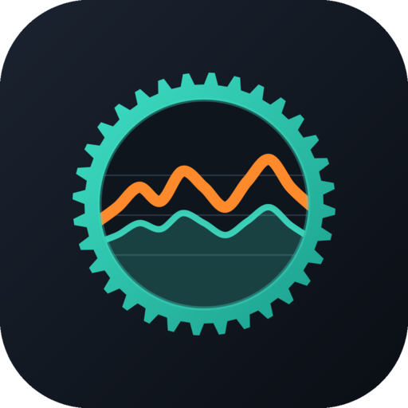

<p align="center"></p>

# avinox-ridedata-server

Python-Server und Auswertung für Fahrdaten vom DJI-Avinox-Antrieb. Übersicht des Gesamtprojekts: [../README.md](../README.md).

## Stand

- Parser für die Fahrtaufzeichnungen `ride_rec/**/ride_rec_<id>.proto` (Header, Frames, Samples mit ca. 1 Hz)
- Kennzahlen je Fahrt wie in der Avinox-App (vom Display berechnet und im Header gespeichert)
- Auswertung: Zeit je Unterstützungsmodus und Gang, Verteilungen (Leistung, Trittfrequenz, Tempo, Steigung, Puls), Bestleistungen 5 s – 60 min, Energie und Motoranteil, Akkuverbrauch, Stopps, Zeitreihe für Diagramme
- GPS-Strecke als GeoJSON (vereinfacht, mit Messwerten je Punkt) und GPX (mit Leistung, Trittfrequenz, Puls)
- Nutzungsstatistik `buried_rec/buried_file_cur.json`: Firmware, Akku (Zellspannungen, Strom, Temperaturen), Sekunden je Gang/Modus, Neigung, Fernbedienung – automatisch der Fahrt zugeordnet
- Meldungen `hms_rec/hms_current_storage.proto`

## Benutzung

```sh
cd server
uv sync
uv run avinox summary /Volumes/<display>/ride_rec                 # Tabelle aller Fahrten
uv run avinox analyze /Volumes/<display>/ride_rec/<…>.proto       # vollständige Auswertung (JSON)
uv run avinox gpx     /Volumes/<display>/ride_rec/<…>.proto -o fahrt.gpx
uv run avinox geojson /Volumes/<display>/ride_rec/<…>.proto -o fahrt.geojson
uv run avinox device  /Volumes/<display>/buried_rec/buried_file_cur.json
uv run pytest
```

## Firmware-Verwaltung

Hochladen, als aktuell setzen und Löschen von ESP32-Firmware (Weboberfläche und `/api/v1/firmware`) ist nur mit aktivem Login (siehe unten) und als Administrator möglich; sonst antwortet der Server mit 403, denn Firmware läuft per OTA als Code auf dem ESP32. Ohne Login geht es lokal auf dem Server mit `avinox firmware add`.

## Login und OIDC

Der Login ist aktiv, sobald es mindestens einen Benutzer gibt oder OIDC eingerichtet ist. Sonst bleibt alles im LAN offen wie bisher.

- **Start-Admin:** `AVINOX_WEB_USER`/`AVINOX_WEB_PASSWORD` legen beim Start einen Administrator an, falls es den Benutzer noch nicht gibt (ein vorhandener wird nie überschrieben). Weitere Benutzer, Passwortänderung und Zurücksetzen: Einstellungen, Karte „Anmeldung“.
- **Webseite:** Anmeldeformular unter `/login`, optional „Angemeldet bleiben“ (30 Tage, sonst 12 Stunden). Sessions liegen serverseitig in SQLite und überleben einen Neustart. Nach 10 Fehlversuchen in 15 Minuten (je IP und Benutzer) wird die Anmeldung kurz gesperrt.
- **API und Skripte:** `/api/v1/...` antwortet ohne Anmeldung mit 401. Zusätzlich zum Session-Cookie geht Basic Auth (`curl -u benutzer:passwort`) für Passwortbenutzer. Der ESP32 nutzt weiter nur das Upload-Token.
- **OIDC (optional):** `AVINOX_OIDC_ISSUER` und `AVINOX_OIDC_CLIENT_ID` (dazu meist `AVINOX_OIDC_CLIENT_SECRET`) einrichten, beim Anbieter die Redirect-URI `<Adresse>/auth/oidc/callback` eintragen (Adresse = `AVINOX_PUBLIC_URL` oder die aufgerufene). `AVINOX_OIDC_ALLOWED` begrenzt auf E-Mail-Adressen oder Gruppen (Claim `groups`; E-Mails zählen nur mit `email_verified: true` im ID-Token), `AVINOX_OIDC_ADMIN` bestimmt die Administratoren (leer = alle OIDC-Benutzer), `AVINOX_OIDC_NAME` ist die Beschriftung des Knopfes. Es wird PKCE (S256) mit `state` und `nonce` genutzt. OIDC-Benutzer werden nie automatisch mit einem Passwortbenutzer gleichen Namens verknüpft.
- Hinter HTTPS-Proxy bekommt das Session-Cookie automatisch `Secure` (Proxy-Header, siehe `FORWARDED_ALLOW_IPS`).

## KI-Auswertung (optional)

Ein Sprachmodell formuliert aus berechneten Kennzahlen kurze Texte und Tipps zu einer Fahrt bzw. einem Zeitraum (Fahrtseite und Übersicht). Standardmäßig aus.

**Einrichtung** (Einstellungen, oder per API `PUT /api/v1/settings/ai`): Anbieter wählen, Schlüssel eintragen, Modell prüfen, einschalten. Genutzt wird das OpenAI-kompatible Format `POST {Adresse}/chat/completions`; Voreinstellungen für OpenRouter, OpenAI, Anthropic, Mistral, Groq und Ollama (lokal, ohne Schlüssel), dazu „Eigene Adresse“ (z. B. LM Studio). Der Schlüssel liegt nur in der Datenbank und wird nie von der API zurückgegeben (nur die letzten vier Zeichen). `POST /api/v1/settings/ai/test` prüft die Verbindung, `POST /api/v1/settings/ai/fill` erstellt fehlende Texte für alle Fahrten ab 1 km und alle Zeiträume nach. Neue Fahrten werden im Hintergrund automatisch ausgewertet; geänderte Daten oder ein Modellwechsel erzeugen den Text neu.

**Gesendet werden nur Kennzahlen:** Strecke, Dauer, Tempo, Höhenmeter, Fahrer-/Motorleistung, Motoranteil, Trittfrequenz, Puls, Zeit je Unterstützungsmodus und Gang, Schaltvorgänge, Steigungsbereiche, Akku, Vergleich mit den anderen Fahrten bzw. dem Vorzeitraum, Bestwerte. **Nie** gesendet werden GPS-Daten, Ortsnamen, Fahrt- und Dateinamen, Seriennummern oder Benutzernamen. Bei einem Cloud-Anbieter verlassen diese Zahlen den Server; mit Ollama bleibt alles lokal.

## Server (Docker)

```sh
docker compose up -d --build
```

Danach läuft die Webseite unter `http://<host>:8000/` (Übersicht mit Zeiträumen Tag/Woche/Monat/Jahr, Vergleich und Bestwerten; die Fahrtenliste unter `/rides`), die API-Doku unter `http://<host>:8000/api/docs`. Alle Daten (Rohdateien, Datenbank, Token) liegen im Volume unter `/data`.

**Upload-Token:** Ohne `AVINOX_UPLOAD_TOKEN` erzeugt der Server beim ersten Start ein zufälliges Token und legt es in `/data/upload_token` ab:

```sh
docker compose exec avinox cat /data/upload_token
```

Alternativ das Token per `AVINOX_UPLOAD_TOKEN` in `docker-compose.yml` fest setzen. Auf der Seite „Einstellungen“ stehen Server-URL und Token zum Eintragen im ESP32-Portal. Uploads sind auf `AVINOX_MAX_UPLOAD_MB` je Datei bzw. Anfrage begrenzt.

Hinter einem HTTPS-Reverse-Proxy funktioniert die Webseite ohne Zusatzeinstellung (Assets werden wurzelrelativ verlinkt). Damit Sync-Log und Fehlermeldungen die echte Client-IP zeigen, die IP des Proxys als `FORWARDED_ALLOW_IPS` setzen (z. B. `FORWARDED_ALLOW_IPS: "172.18.0.1"`). Nicht `*` verwenden: Dann kann jeder Client seine IP fälschen.

**Achtung:** Ohne Login (kein Benutzer, kein OIDC) sind Webseite und Lese-API für jeden im LAN offen. Nicht ohne Login ins Internet stellen.

### Umgebungsvariablen

| Variable | Standard | Bedeutung |
|---|---|---|
| `AVINOX_DATA_DIR` | `./data` (im Container `/data`) | Rohdateien, Datenbank, Upload-Token |
| `AVINOX_UPLOAD_TOKEN` | zufällig, in `<data>/upload_token` | Bearer-Token für Uploads (ESP32) |
| `AVINOX_WEB_USER` / `AVINOX_WEB_PASSWORD` | leer | Start-Admin, wird beim Start angelegt, falls es den Benutzer noch nicht gibt; aktiviert den Login |
| `AVINOX_OIDC_ISSUER` / `AVINOX_OIDC_CLIENT_ID` / `AVINOX_OIDC_CLIENT_SECRET` | leer | Anmeldung über OpenID Connect (Secret optional) |
| `AVINOX_OIDC_NAME` | `SSO` | Beschriftung des Knopfes „Mit … anmelden“ |
| `AVINOX_OIDC_SCOPES` | `openid email profile` | Angeforderte Scopes |
| `AVINOX_OIDC_ALLOWED` | leer | Kommagetrennt: erlaubte E-Mails oder Gruppen; leer = jeder, den der Anbieter durchlässt |
| `AVINOX_OIDC_ADMIN` | leer | Wer Administrator wird (gleiche Schreibweise); leer = alle OIDC-Benutzer |
| `AVINOX_PUBLIC_URL` | leer | Adresse(n) des Servers für den ESP32, kommagetrennt, z. B. `https://avinox.example.org,http://192.168.1.18:8000`; die Einstellungsseite bietet zusätzlich die aufgerufene Adresse und die LAN-IP an |
| `AVINOX_TZ` | `Europe/Berlin` | Zeitzone für die Anzeige |
| `AVINOX_MAP_STYLE` | `https://tiles.openfreemap.org/styles/liberty` | Style-URL (MapLibre, Vektorkarte) für Fahrtkarte und 3D-Ansicht; die 3D-Höhen kommen von den AWS Terrain Tiles |
| `AVINOX_MAX_UPLOAD_MB` | `64` | Größte erlaubte Datei |

### Upload-Protokoll (ESP32)

Alle Aufrufe mit `Authorization: Bearer <token>`. `path` ist der Pfad relativ zur Wurzel des Display-Laufwerks (z. B. `ride_rec/ride_rec_12.proto`).

1. `GET /api/v1/manifest` – bekannte Dateien (Pfad + Größe) und die angenommenen Pfadmuster.
2. `GET /api/v1/upload/status?path=…&size=…` – wie viele Bytes der Datei schon angekommen sind.
3. `PUT /api/v1/upload?path=…&size=…&offset=…` – rohe Bytes ab `offset` (stückweise möglich). Passt `offset` nicht zum Stand auf dem Server, kommt `409` mit dem tatsächlich empfangenen Stand; dort weitermachen.

```sh
curl -X PUT -H "Authorization: Bearer $TOKEN" \
  --data-binary @ride_rec_12.proto \
  "http://<host>:8000/api/v1/upload?path=ride_rec/ride_rec_12.proto&size=$(stat -f%z ride_rec_12.proto)&offset=0"
```

(`stat -f%z` unter macOS, `stat -c%s` unter Linux.)

Ohne ESP32 lassen sich Dateien auch über die Webseite hochladen: **Einstellungen → Dateien hochladen**, dann den Ordner des Display-Laufwerks wählen. Verschlüsselte `ebike_log_*.dat` werden dabei ignoriert.
